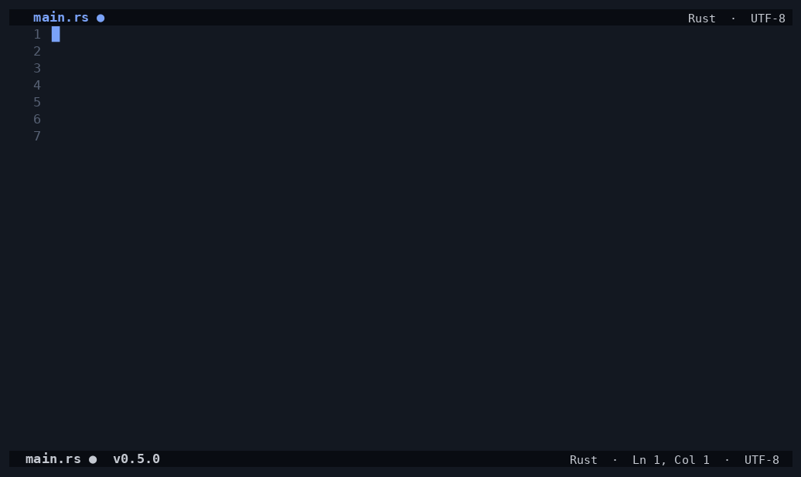

<p align="center">
  
</p>

# Fast Text


[](https://github.com/Fast-Text-editor/Fast-text-editor/actions/workflows/ci.yml)
[](https://github.com/Fast-Text-editor/Fast-text-editor/releases)
[](LICENSE)
[](https://www.rust-lang.org)

**A zero-bloat, multi-frontend text editor in Rust — Terminal (TUI), Native GUI, and Web/WASM — with built-in LSP, 340+ languages, and an embedded scripting & automation language.**

## Showcase

| Editing and the command palette | Nested split panes |
| --- | --- |
|  |  |

## Why Fast Text?

- **One Engine, Three Frontends:** The same rope-based core, themes, and keybindings power Terminal (`ratatui`), Desktop (`egui`), and Browser (WASM).
- **Batteries Included, Zero Config:** Built-in LSP auto-detection, 340+ languages, an embedded PTY terminal (`Alt+C`), and 26 ready-to-use plugins.
- **Programmable Automations (TextWrite):** Script edits, custom themes, and timed UI automations in a clean, built-in language (or Rhai).
- **Optional Vim Layer (`Alt+V`):** Switch seamlessly between modern editor shortcuts and Vim modal editing.

## Quick start

```sh
curl -fsSL https://raw.githubusercontent.com/Fast-Text-editor/Fast-text-editor/main/install.sh | sh
```

```sh
ft file.rs          # open a file
ft -O a.rs b.rs     # open as split panes
ft --gui file.rs    # launch native GUI (if installed)
```

<details>
<summary>Install options & build from source</summary>

### Installer flags

| Flag | Effect |
| --- | --- |
| `--prefix DIR` | Install under `DIR` (default `$HOME/.local`, or `/usr/local` as root) |
| `--bin-dir DIR` | Put executables in `DIR` instead of `PREFIX/bin` |
| `--from-source` | Skip prebuilt release and build with cargo |
| `--version TAG` | Install a specific release tag |
| `--gui` / `--no-gui` | Install or skip `fast-text-gui` |
| `--no-modify-path` | Do not edit shell rc files |

Windows PowerShell:

```powershell
irm https://raw.githubusercontent.com/Fast-Text-editor/Fast-text-editor/main/install.ps1 | iex
```

### Build from source

```sh
cargo run -p fast-text-tui -- file.rs
cargo run -p fast-text-gui -- file.rs   # needs X11/Wayland display
cargo run -p textwrite -- script.tw
cargo test
./web/serve.sh
```

`cargo install --path crates/fast-text-tui` installs `fast-text` and `ft`.
`cargo install --path crates/fast-text-gui` installs `fast-text-gui`.

</details>

## Layout

```text
fast-text/
├── crates/
│   ├── fast-text-core/      # rope buffer, edits, undo/redo, find, fuzzy match
│   ├── fast-text-syntax/    # stateful, dependency-free syntax highlighting
│   ├── fast-text-theme/     # shared TOML theme schema (TUI/GUI/Web)
│   ├── fast-text-plugin/    # Rhai/TextWrite bridge, shared keymap
│   ├── fast-text-lsp/       # minimal Language Server Protocol client
│   ├── fast-text-tui/       # terminal frontend (ratatui) — fast-text / ft
│   ├── fast-text-gui/       # native desktop frontend (egui/eframe)
│   ├── fast-text-wasm/      # WebAssembly bindings
│   ├── fast-text-textwrite/ # TextWrite editor scripting bridge
│   └── textwrite/           # TextWrite language — textwrite / tw
├── docs/                    # scripting, keybindings, plugins, TextWrite docs
├── plugins/                 # example Rhai/TextWrite plugins
├── automations/             # one-shot TextWrite demos for Alt+R
└── web/                     # browser frontend
```

## By the numbers

| | |
| --- | --- |
| **Core model** | Rope-based buffer (`ropey`) with persistent undo, multi-cursor, and fuzzy matching |
| **Syntax** | Dependency-free, stateful line highlighter; curated core + 340+ generated language entries from Helix |
| **Frontends** | 1 engine, 3 user frontends (TUI, GUI, WASM) + embeddable core crate |
| **Extensibility** | 26 first-party TextWrite plugins, Rhai/TextWrite scripting, custom TOML themes |
| **LSP** | Built-in client with auto-detection and install hints; `FAST_TEXT_LSP=0` disables it |

> Exact binary size/startup depend on platform and build flags. Fast Text avoids heavy C syntax-binding dependencies and keeps editing logic in a shared Rust core.

## Core features

### Language support & LSP
- **340+ languages** via curated definitions plus a Helix-generated registry.
- **Built-in LSP client** for completion, hover, definition, formatting, code actions, rename, and symbols.
- Missing-server hints show the exact install command; Fast Text never installs tools without consent. Disable with `FAST_TEXT_LSP=0`.

### Terminal, editing, and workflows
- **Embedded PTY terminal** (`Alt+C`) with ANSI, scrollback, and full-screen program support.
- **Nested split panes** (`ft -O ...`), tabs, mouse editing, multi-cursor, macros, find-in-files.
- **Fuzzy file finder** (`Ctrl+P`) and **command palette** (`Ctrl+Shift+C`).

### Plugins, themes, and scripting
- **26 first-party plugins** installable from the plugin manager (`Alt+M`).
- **11 built-in themes** + custom TOML themes in `~/.config/fast-text/themes/`.
- **TextWrite** for scripts/automations (`Ctrl+E`, `Alt+R`) and **Rhai** for plugins.

See: [Keybindings](docs/keybindings.md) · [Plugins & themes](docs/plugins.md) · [TextWrite](docs/textwrite.md) · [Scripting bridge](docs/scripting.md)

## Power shortcuts

| Key | Action | Key | Action |
| --- | --- | --- | --- |
| `Ctrl+Shift+C` | Command palette | `Ctrl+P` | Fuzzy file finder |
| `Alt+C` | Terminal panel | `Alt+V` | Toggle Vim layer |
| `Alt+M` | Plugin manager | `Alt+R` | Run TextWrite automation |
| `Ctrl+D` | Select next occurrence | `Ctrl+S` | Save |

<details>
<summary>View all default keybindings & command IDs</summary>

See the full table and rebinding guide in [docs/keybindings.md](docs/keybindings.md).

</details>

## Configuration

Config file: `$XDG_CONFIG_HOME/fast-text/config.toml` (usually `~/.config/fast-text/config.toml`).
Override with `FAST_TEXT_CONFIG` or `--config PATH`.

```toml
[editor]
theme = "dark"        # dark, light, gojo, monokai, ...
sidebar = false
lsp = true
vim = false

[console]
windows = "default"   # default | cmd | powershell | pwsh
linux = "default"
macos = "default"

[keys]
"ctrl+shift+s" = "save_as"
"alt+w" = "close"
```

<details>
<summary>Updates, release assets, and environment variables</summary>

### Updates

- Fast Text checks GitHub releases on startup (throttled to once/day). Disable with `[update] check = false` or `FAST_TEXT_UPDATE_CHECK=0`.
- Manual check: `Alt+U` in TUI/GUI.
- CLI: `fast-text update [--check] [--yes] [--version TAG]`.

### Release assets

Tagged releases publish `fast-text-<target>.tar.gz` (or `.zip` on Windows) for:
`x86_64-unknown-linux-gnu`, `aarch64-unknown-linux-gnu`, `x86_64-apple-darwin`,
`aarch64-apple-darwin`, `x86_64-pc-windows-msvc`.

### Useful environment variables

| Variable | Effect |
| --- | --- |
| `FAST_TEXT_CONFIG` | Override config file path |
| `FAST_TEXT_LSP=0` | Disable LSP |
| `FAST_TEXT_UPDATE_CHECK=0` | Disable startup update checks |
| `FAST_TEXT_LOG` | LSP log path (`1`/`true` for default path) |

</details>

## Frontends

| Frontend | Crate | Notes |
| --- | --- | --- |
| **Terminal** | `fast-text-tui` | ratatui TUI, `fast-text` / `ft` binaries |
| **Desktop** | `fast-text-gui` | egui/eframe native window |
| **Web** | `fast-text-wasm` + `web/` | Engine compiled to WASM |
| **Library** | `fast-text-core` | Embeddable editing engine |

All frontends share the same core semantics, keymap, and TOML theme schema.

## Engine design

- **Buffer**: `ropey` rope with load/save, dirty tracking, revision counter.
- **Document**: cursor movement, goal column, selections, undo/redo, find/replace, multi-cursor, plugin range edits.
- **History**: reversible grouped edits; persistent undo snapshots (atomic `.json.tmp` → `.json`).
- **Syntax**: stateful, dependency-free lexer carrying block-comment/multi-line-string state across lines; curated + Helix-generated language data.
- **Fuzzy matching**: subsequence scorer used by file finder and pickers.

## License

MIT
