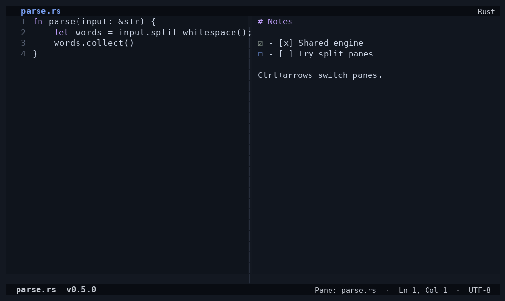

<p align="center">
  
</p>

# Fast Text


[](https://github.com/Fast-Text-editor/Fast-text-editor/actions/workflows/ci.yml)
[](https://github.com/Fast-Text-editor/Fast-text-editor/releases)
[](LICENSE)
[](https://www.rust-lang.org)

A fast, modern text editor written in Rust. Fast Text is built as a **Cargo
workspace** with a single powerful engine and thin frontends layered on top, so
the editor behaves identically everywhere.

## Showcase

| Editing and the command palette | Nested split panes |
| --- | --- |
|  |  |

`ft -O file1 file2` opens files as nested panes instead of tabs. Everything
else — themes, keybindings, scripts — is shared with the desktop and web
frontends.

## Quick start

```sh
curl -fsSL https://raw.githubusercontent.com/Fast-Text-editor/Fast-text-editor/main/install.sh | sh
```

That installs the editor (`fast-text`, `ft`) and the TextWrite language
(`textwrite`, `tw`) — see [Install](#install) for the flags and
[Building and running](#building-and-running) to build from source instead.

## Layout

```
fast-text/
├── crates/
│   ├── fast-text-core/    # the engine: rope buffer, edits, undo/redo, find, fuzzy match
│   ├── fast-text-syntax/  # stateful, dependency-free syntax highlighting
│   ├── fast-text-theme/   # one TOML theme schema shared by the TUI, GUI and web
│   ├── fast-text-plugin/  # Rhai plugins, TextWrite bridge types, shared keymap
│   ├── fast-text-lsp/     # a minimal Language Server Protocol client
│   ├── fast-text-wasm/    # WebAssembly bindings for the engine
│   ├── fast-text-gui/     # native desktop frontend (egui/eframe)
│   ├── fast-text-tui/     # terminal frontend (ratatui) — the `fast-text` / `ft` binaries
│   │   ├── plugin-catalog/ # 26 first-party TextWrite scripts, embedded via include_str!
│   │   └── registry/      # offline plugin index (`index.json`)
│   ├── fast-text-textwrite/ # TextWrite editor scripts: the `ScriptHost` bridge
│   └── textwrite/         # TextWrite: the Fast Text scripting language — `textwrite` / `tw`
├── docs/                  # scripting and integration guides
├── assets/                # README showcase GIFs
├── tools/gen_langs.py     # generates the language registry from Helix
├── plugins/               # example plugins, Rhai and TextWrite (loaded at startup)
├── automations/           # one-shot TextWrite demos for Alt+R
├── web/                   # browser frontend (see web/README.md)
├── install.sh             # universal installer: prebuilt release or source build
└── .github/workflows/     # CI (fmt, clippy, tests) and tagged release binaries
```

## Why this shape

Every frontend is a *thin shell* over `fast-text-core`. The engine knows nothing
about terminals, windows, or browsers; it just tracks text, cursors, and
history. That means:

- the same editing semantics (undo grouping, persistent undo, word motion, goal
  columns, fuzzy matching, multiple cursors, search) work in every frontend;
- one shared keymap and one shared TOML theme schema keep `Ctrl+S`, `Ctrl+Shift+P`,
  `Alt+T`, colors and messages identical in the terminal, desktop and browser;
- the core is trivially testable without a UI;
- new frontends (native GUI, web/WASM) reuse all of the editing logic.

## Building and running

```sh
cargo run -p fast-text-tui              # terminal editor: welcome buffer
cargo run -p fast-text-tui -- file.rs   # terminal editor: one or more files
cargo run -p fast-text-tui -- -O a.rs b.rs  # open files as split panes
cargo run -p fast-text-tui --bin ft     # same editor, short alias
cargo run -p fast-text-tui -- --gui [file]  # launch the desktop GUI
cargo run -p fast-text-gui -- file.rs   # native desktop window (needs a display)
cargo run -p textwrite -- file.tw       # run a TextWrite script
cargo run -p textwrite                  # TextWrite REPL
cargo test                              # run the whole test suite
./web/serve.sh                          # build + serve the web frontend
```

The terminal editor builds two identical binaries: **`fast-text`** and the short
alias **`ft`**. After `cargo install --path crates/fast-text-tui` you can open a
file with `ft file.py` or `fast-text file.py`.

The native GUI needs a windowing system (X11 or Wayland). Running it over a
plain SSH session without a display fails with winit's
`neither WAYLAND_DISPLAY nor WAYLAND_SOCKET nor DISPLAY is set` — that is
expected, not a build problem.

Opening a path that does not exist yet (for example `ft notes.py`) starts a new
empty buffer named `notes.py`, highlighted according to the file name, ready for
`Ctrl+S` to write it. Run `ft` with no arguments to see the Rust welcome buffer
instead.

## Install

One self-contained shell script installs the editor, the TextWrite language and,
optionally, the desktop app. It uses a prebuilt release when one exists for your
platform and otherwise builds from source with cargo:

```sh
curl -fsSL https://raw.githubusercontent.com/Fast-Text-editor/Fast-text-editor/main/install.sh | sh
```

| Flag | Effect |
| --- | --- |
| `--prefix DIR` | Install under `DIR` (default `$HOME/.local`, or `/usr/local` as root) |
| `--bin-dir DIR` | Put the executables in `DIR` instead of `PREFIX/bin` |
| `--from-source` | Skip the prebuilt release and build with cargo |
| `--source DIR` | Build from the checkout in `DIR` (implies `--from-source`) |
| `--gui` | Also install the desktop app |
| `--version TAG` | Install a specific release tag |
| `--no-completions` | Do not install shell completions |
| `--uninstall` | Remove everything a previous run installed |
| `--check` | Compare the installed version with the newest release |
| `--update` | Install the newest release over the current install |
| `--dry-run` | Print what would happen and change nothing |

It installs `fast-text` / `ft`, `textwrite` / `tw`, and bash and zsh
completions, and records every path in `PREFIX/share/fast-text/installed-files`
so `--uninstall` is exact. When the prefix is not writable the script uses
`sudo` if it is available.

Running it again over an existing installation **upgrades that copy in place**:
it reads the recorded version, keeps the desktop app if you had installed it
before, and installs the newest release — so simply re-running the one-liner
delivers new features to the editor you already have. When neither `--prefix`
nor `--bin-dir` is given, an existing `fast-text` on `PATH` decides where the
upgrade lands, so the copy your shell finds is the one that gets updated. If
you installed with `cargo install` or a package manager instead, `--check`
still finds it through `PATH` and tells you the version it sees.

Prebuilt archives are published for **x86_64 and aarch64 Linux** (glibc) and
**x86_64 and aarch64 macOS**; every other platform builds from source
automatically. Releases are produced by `.github/workflows/release.yml` when a
`v*` tag is pushed.

**Termux/Android** is detected automatically: the prebuilt Linux archives link
glibc, which cannot run against Android's bionic libc, so the installer builds
natively instead. Install the toolchain first with `pkg install rust git`.

## Updates

Fast Text knows when a newer release exists. At startup it asks GitHub once a
day (in the background, so it never blocks the editor) and, when something
newer is out, opens a small window naming the version with **Yes, update** and
**Not now** buttons. `Yes` downloads the release, unpacks it, swaps the
executables in place and then offers to restart; the editor itself never
re-execs without asking. `Alt+U` (or *Check for updates* in `Ctrl+Shift+P`)
checks on demand, and the version you are running is shown in the status bar.

```toml
[editor]
check_updates = true   # set to false to never check
```

Setting `FAST_TEXT_UPDATE_CHECK=0` disables checking whatever the config says.
A release you answer "Not now" to is not offered again until an even newer one
appears. On platforms without a prebuilt archive the check still runs but
reports that you should rebuild from source.

The installer can do the same from the shell:

```sh
sh install.sh           # notices an existing install and upgrades it
sh install.sh --check     # "Update available: v0.2.0 … v0.3.0"
sh install.sh --update    # install the newest release in place
```

`install.ps1` on Windows takes `-Check` and `-Update`. Both record the
installed version in `PREFIX/share/fast-text/installed-version`, and the
desktop app has the same dialog under **Help → Check for updates**.

## Keys

| Key | Action | Key | Action |
| --- | --- | --- | --- |
| `Ctrl+S` | Save | `Ctrl+Z` / `Ctrl+Y` | Undo / Redo |
| `F2` | Save as | `Ctrl+A` | Select all |
| `Ctrl+O` | Open file | `Ctrl+X` / `Ctrl+C` / `Ctrl+V` | Cut / Copy / Paste |
| `Ctrl+N` | New buffer | `Ctrl+F` | Find |
| `Ctrl+W` | Close buffer | `F3` / `F4` | Find next / previous |
| `Ctrl+Q` | Quit | `Ctrl+H` | Replace all |
| `Ctrl+G` | Go to line | `Ctrl+T` | Toggle theme |
| `Ctrl+L` | Language picker | `Ctrl+P` | Fuzzy file finder |
| `Ctrl+Shift+P` | Command palette | `Alt+:` | `:` command bar |
| `Ctrl+Space` | Complete | `F5` | Hover info |
| `F12` | Go to definition | `Alt+H` | Help |
| `Esc` | Collapse selection | `Alt+M` | Plugin manager |
| `Ctrl+B` | Toggle explorer | `Ctrl+Shift+O` | Open folder |
| `Ctrl+Tab` / `Ctrl+Shift+Tab` | Next / previous tab | `Alt+1` `Alt+2` `Alt+3` | Cursor bar / block / underline |
| `Ctrl+Shift+F` / `Alt+F` | Find in files | `Ctrl+D` | Select next occurrence |
| `Alt+O` | Document symbols | `Alt+N` | Rename symbol |
| `Ctrl+Shift+I` | Format document | `Ctrl+.` | Code actions |
| `Ctrl+/` | Toggle comment | `Ctrl+Shift+D` | Duplicate line |
| `Ctrl+Shift+K` | Delete line | `Alt+↑` / `Alt+↓` | Move line up / down |
| `Alt+Shift+↑` / `Alt+Shift+↓` | Add cursor above / below | `F6` / `F7` | Record / replay macro |
| `Alt+U` | Check for updates | `Alt+C` | Terminal panel |
| `Alt+V` | Toggle Vim layer | `Ctrl+←/↑` `Ctrl+→/↓` | Previous / next split pane |

A few chords are terminal-dependent (`Ctrl+Shift+<letter>`, `Ctrl+.`). Every
action also has a palette entry and a `[keys]` id, so you can rebind it — for
example `"alt+shift+f" = "find_in_files"`. `Cmd` on macOS is treated as `Ctrl`,
so the familiar shortcuts work without a second keymap.

`Shift` + arrows extends the selection; `Alt` + left/right moves by word. With
more than one pane open, `Ctrl` + arrows moves focus between panes instead.

`Ctrl+L` opens a fuzzy-filterable picker listing **every supported language**
(300+). Type to narrow, `↑`/`↓` to move, `Enter` to apply.

`Ctrl+P` opens a **fuzzy file finder** over the explorer's folder; type a few
characters, then `Enter` to open the highlighted match. `Ctrl+Shift+P` opens the
**command palette**, which includes every built-in action plus commands
registered by scripts. Both use the same fuzzy matcher in `fast-text-core`.

`Ctrl+B` shows a Visual-Studio-style **folder explorer** along the left edge,
rooted at the folder you launched from (or `Ctrl+Shift+O` to pick another).
`↑`/`↓` move, `→` expands or steps in, `←` collapses or steps out, `Enter`
opens a file, `n` creates a **new file** and `N` a **new folder** next to the
highlighted row (an inline prompt at the panel's foot asks for a plain name —
no slashes or dot-names — and opens the file you just made), `r` reloads, and
`.` toggles dotfiles. With the mouse you can click a file to open it, click a
tab to switch, and click a tab's `✕` to close it.

Mouse editing works in the text area too: click to place the caret, drag or
`Shift`-click to select, and scroll with the wheel. The view can be scrolled
independently of the caret when you want to look ahead.

`Alt+C` opens a **real terminal**: Fast Text starts your `$SHELL` in a
pseudo-terminal and renders its ANSI output in the panel, so colours, readline,
`vim`, `htop` and other full-screen programs work just as they do in a standalone
terminal. The session persists while the editor is open: `cd`, exports and
aliases carry over. `↑`/`↓` are the shell's own history; `Ctrl+Up/Down` (or
`Ctrl+PageUp/PageDown`), the mouse wheel, or the scrollbar on the panel's right
edge browse 2000 lines of scrollback. `Esc` or `Alt+C` closes the panel without
killing the shell. The panel resizes with the window, and a plain line editor is
used as a fallback when a PTY cannot be opened.

`Ctrl+Shift+F` (or `Alt+F`) opens **find in files**: type a query, `Tab` toggles
case sensitivity, and `Enter` on a result jumps straight to the hit. Search runs
over the explorer's current folder.

`Ctrl+D` adds the **next occurrence** of the word under the caret as another
caret, and `Alt+Shift+↑`/`Alt+Shift+↓` add one on the line above/below; typing
then edits every caret at once as a single undo step. `F6` starts recording a
**macro**, `F7` replays the last one, and *Save macro…* names one so you can bind
it (`"alt+k" = "macro_tidy imports"`).

`ft -O file1 file2` (or `--split`) opens files as **nested split panes** instead
of tabs. Use *Split pane right/down*, *Focus next/previous pane* and *Close pane*
from the palette, or `Ctrl` + arrows to change focus. Panes can nest arbitrarily.

`Alt+V` toggles an optional **Vim layer**: `i` enters insert mode, `Esc` returns
to Normal, `d`/`y`/`c` work as operators with motions, and `v`/`V` select.
`Alt+:`, or a bare `:` in Normal mode, opens the command bar: `:w`, `:q`, `:q!`,
`:wq`, `:e`, `:theme`, `:set vim`, `:set diagnostics`, `:help` and `:ls` all
work, and anything else is evaluated as TextWrite.

With a language server running (see [Language servers](#language-servers)),
`Ctrl+Shift+I` formats the document, `Ctrl+.` offers code actions, `Alt+N`
renames the symbol under the cursor, and `Alt+O` lists document symbols.

## Configuration

Every key above is rebindable. Settings live in
`$XDG_CONFIG_HOME/fast-text/config.toml` (usually
`~/.config/fast-text/config.toml`); `FAST_TEXT_CONFIG` or `--config PATH`
override that. The file is optional — a missing file just means defaults, and
bad lines are reported in the status bar rather than stopping the editor.

```toml
[editor]
cursor_style = "bar"      # bar | block | underline
theme        = "one-dark" # any of the ten built-in or user themes
sidebar      = false      # start with the folder explorer visible
lsp          = true       # talk to language servers (as FAST_TEXT_LSP)
inline_diagnostics = true # show LSP messages under the affected line
vim          = false      # start with the optional Vim layer on
check_updates = true      # look for a newer release at startup (as Alt+U)

[sidebar]
hidden = false            # list dot-files

[keys]
"f1"     = "help"
"alt+m"  = "manage_plugins"
"ctrl+k" = "cursor_block"
```

Pick *Reload config* from the `Ctrl+Shift+P` palette to apply changes without
restarting, or *Open config file*, which opens the file and writes a fully
commented template the first time it is needed.

### Custom keybindings

`[keys]` maps a key spelling to a command. The command is either a built-in id
(listed below) or any command title from the `Ctrl+Shift+P` palette, including plugin
and TextWrite commands:

```
save, save_as, open, new, close, quit, undo, redo, select_all,
clear_selection, copy, cut, paste, find, find_next, find_prev, replace,
goto_line, language, command_palette, complete, hover, definition,
eval_textwrite, run_automation, toggle_theme, toggle_sidebar, open_folder,
manage_plugins, install_plugin, cursor_bar, cursor_block, cursor_underline,
help, next_tab, prev_tab, reload_config, open_config,
find_in_files, document_symbols, rename_symbol, format_document,
code_actions, toggle_comment, duplicate_line, delete_line, move_line_up,
move_line_down, select_next_occurrence, cursor_above, cursor_below,
record_macro, replay_macro, save_macro, check_updates,
file_finder, toggle_console, repl, split_pane_right, split_pane_down,
close_pane, focus_next_pane, focus_previous_pane, restore_default_status_line,
command_line, vim, toggle_inline_diagnostics, install_language_server
```

The first block is the shared keymap (`fast-text-plugin::keymap`), used by the
TUI, GUI and WASM frontends; the second block adds TUI-specific panes, hooks and
commands. macOS `Cmd`/`Super` is translated to `Ctrl`, so one binding covers
both.

A named macro can also be bound with the id `macro_<name>`.

Spellings use the same grammar as plugin bindings — `ctrl+k`, `alt+left`, `f5`,
`shift+enter` — and a user binding takes precedence over every built-in one. A
bare letter with no modifier is refused, because it would stop you typing it.

### Command line

| Option | Effect |
| --- | --- |
| `-h`, `--help` | Print usage |
| `-V`, `--version` | Print the version |
| `-c`, `--config PATH` | Read settings from `PATH` |
| `-O`, `--split` | Open the listed files as nested split panes |
| `--` | Treat every later argument as a file name |

Plugin registry commands are also available on the CLI:

```sh
ft plugin list                 # installed plugins and registry size
ft plugin search markdown      # search by name, title, tag or description
ft plugin install smart-brackets   # install a bundled plugin (no network)
ft install status-formats      # shorthand for `ft plugin install`
ft plugin remove wrap          # delete an installed plugin
ft plugin help
```

Bundled entries install from the embedded catalog; only non-bundled entries
fetch their source. Pass `--force` to overwrite an installed plugin.

`FAST_TEXT_LSP=0` turns language servers off even when `config.toml` asks for
them.

## Languages

Fast Text highlights **340+ languages**. A hand-curated core (below) ships with
tailored keyword/type/constant lists, comments, and string rules; everything
else is generated from Helix's configuration:

| Curated | Generated from Helix |
| --- | --- |
| Rust, JavaScript, TypeScript, Python, Ruby, Java, C, C++, C#, Go, HTML, CSS, JSON, TOML, Markdown, Shell, TextWrite, plain text | Zig, Kotlin, Haskell, Scala, Clojure, Elixir, Erlang, Dart, Lua, Perl, R, Julia, SQL, YAML, XML, Vue, Svelte, Dockerfile, Make, CMake, Nix, HCL/Terraform, GraphQL, Protobuf, and 300+ more |

The registry in `crates/fast-text-syntax/src/generated.rs` is produced by
`tools/gen_langs.py` from a [Helix](https://helix-editor.com) checkout. It reads
`languages.toml` (file types, comment tokens, block comments, language servers)
and the tree-sitter highlight queries under `runtime/queries/`, extracting the
keyword/type/constant word lists from captures like
`[ "if" "else" ] @keyword.control`. Regenerate with:

```sh
python3 tools/gen_langs.py /path/to/helix
```

C and C++ headers are recognized across the common spellings — `.c`/`.h` are C;
`.cpp`/`.cc`/`.cxx`/`.c++` and `.hpp`/`.hh`/`.hxx`/`.h++`/`.ipp`/`.tpp`/`.tcc`
are C++.

## Language servers

When a supported language server is on `PATH`, Fast Text starts it
automatically and shows:

- **diagnostics** — markers in the gutter (`E`/`W`/`i`), a summary in the status
  bar, and an inline `↳ severity: message` line under each affected line
  (toggle with `:set diagnostics` / `:set nodiagnostics`);
- **completion** (`Ctrl+Space`) in a popup — `↑`/`↓` to choose, `Enter`/`Tab`
  to accept, `Esc` to dismiss;
- **hover** (`F5`) and **go to definition** (`F12`).

Server names and launch commands come from the same Helix-derived table, so the
supported set is large: `rust-analyzer`, `pylsp`/`jedi`, `gopls`, `clangd`,
`typescript-language-server`, `jdtls`, `ruby-lsp`/`solargraph`,
`csharp-ls`/`omnisharp`, `bash-language-server`, `zls`, `haskell-language-server`,
`taplo`, `marksman`, `vscode-json-language-server`, and many more. For each
language Fast Text tries its preferred servers in order and uses the first one
installed. Servers start on a background thread, so the editor never blocks —
and with none installed it behaves exactly as before. For Rust, JavaScript,
TypeScript, Python, Shell, Go and Ruby the editor can suggest a well-known
install command in a consent dialog; nothing runs until you accept, and a
decline is remembered for the session. *Retry language server* in the palette
re-probes after you install one yourself. Disable the integration with
`FAST_TEXT_LSP=0`.

## Plugins and editor scripts

Drop `.rhai` **plugins** or `.tw` **TextWrite scripts** into `plugins/` in your
working directory or `~/.config/fast-text/plugins/`. Each script registers commands and
keybindings; `Ctrl+Shift+P` lists them all. Scripts describe edits as *actions*
(`insert`, `delete_selection`, `move_caret`, `set_language`, `set_theme`, …) and
read editor state from globals (`selected_text`, `document_text`, `has_selection`,
`cursor`, `line`, `file_name`, `language`, `theme`, …):

```rhai
// plugins/example.rhai
fn wrap_in_quotes() {
    if has_selection { insert("\"" + selected_text + "\""); }
}
command_with_desc("Wrap in quotes", "Surround the selection with \"", "wrap_in_quotes");
bind("ctrl+shift+q", "Wrap in quotes");
```

```textwrite
# plugins/example.tw
fn wrap_in_quotes() {
    if has_selection {
        insert("\"" + selected_text + "\"")
    }
}
command_with_desc("Wrap in quotes", "Surround the selection with \"", "wrap_in_quotes")
bind("ctrl+shift+q", "Wrap in quotes")
```

Both languages run against the same editor API (the `EditorAction` queue), so a
script can be written in either. The repository ships examples under `plugins/`:
`example.rhai`, `example.tw`, `cursor.tw`, `text_tools.tw`, `markdown.tw` and
`notes.tw`. Press **`Ctrl+E`** to evaluate a TextWrite snippet against the
current buffer and see the result in the status bar.

For the full bridge — context globals, `selected_text`, selection replacement,
every host function, errors, hooks and status-line formatting — see the dedicated
[TextWrite editor scripting guide](docs/scripting.md).

### The plugin manager

Press **`Alt+M`** (or **`Ctrl+M`**, or pick *Manage plugins* from the `Ctrl+Shift+P`
palette) to open a Visual-Studio-style **plugin manager**. It has two tabs:

* **Installed** lists every plugin found on disk with its runtime, commands,
  keybindings, and any load error, and lets you turn plugins on and off without
  deleting anything.
* **Available** lists the **first-party catalog** — TextWrite plugins compiled
  into the editor. Highlight one and press `Enter` to install it for real: the
  source is written into your plugin directory, where it loads immediately and
  appears under *Installed* like any other plugin.

> **Tip:** a legacy terminal sends the same byte for `Ctrl+M` and `Enter`, so
> `Ctrl+M` only reaches the editor on terminals that speak the kitty / CSI-u
> keyboard protocol. **`Alt+M`** works everywhere, which is why it is the
> primary binding.

| Key | Action |
| --- | --- |
| `↑` / `↓`, `PageUp` / `PageDown`, `Home` / `End` | Move the selection |
| `Tab` / `Shift+Tab` | Switch between *Installed* and *Available* |
| `Space` / `Enter` / `x` | Toggle the plugin, or install the highlighted catalog entry |
| `i` | Install a plugin from a path (on the *Installed* tab) |
| `d` | Uninstall: delete the plugin file (asks for `y` confirmation) |
| `r` | Rescan the plugin directories |
| `Esc` / `q` | Close the manager |

Toggling a plugin takes effect immediately and is remembered in
`~/.config/fast-text/plugins.disabled` (one file name per line). Pressing `i`
(or the palette's *Install plugin…*) asks for a path and copies the file into
`~/.config/fast-text/plugins/`, where it is picked up right away. The manager is
also reachable with the mouse: click a row to select it, then click it again to
toggle (or install) it.

At startup Fast Text loads TextWrite and Rhai scripts from
`~/.config/fast-text/plugins/` and `plugins/` relative to the working directory
(the user directory wins on name clashes). Use the manager to disable one
without deleting it, or the [registry CLI](#command-line) to install one by
name.

The catalog ships **26 plugins**, all written in TextWrite and readable under
`crates/fast-text-tui/plugin-catalog/`: **Theme pack**, **Case and lines**,
**Statistics**, **Markdown pro**, **Whitespace**, **Snippets**, **Comments**
(toggle line comments for the right language), **CSV tools** (sort, swap and
prune columns), **Markdown extras** (tables, fences, task lists), **Date
converter** (ISO ⇄ US ⇄ long-form dates, weekday included), **Identifier
cases** (camelCase ⇄ snake_case ⇄ kebab-case ⇄ paths), **Word frequency**,
**Box drawing** (single, rounded, double and heavy boxes), **Align** (line up on
`=`, `:`, `=>` or `|`), **Ciphers** (ROT13 and Atbash), **TODO report** (group
every marker with line numbers), **Wrap** (reflow to 72/80 columns or unwrap),
**Path tools** (separators, base names, directories, quoting), **Smart
brackets** (auto-close and wrap with `()`, `[]`, `{}` and quotes), **Markdown
preview** (readable text view and heading outline), **Status formats** (four
custom status lines with open/save hooks), **Linked TOC**, **Brace formatter**
(indented or one-line JSON/CSS), **SQL casing**, **Markdown tables** and **Log
summary**. The full list is in the
[catalog README](crates/fast-text-tui/plugin-catalog/README.md).

### Themes

Ten themes ship with the editor — `dark`, `light`, `one-dark`, `monokai`,
`dracula`, `nord`, `gruvbox`, `tokyo-night`, `solarized-dark`, and
`solarized-light`. Pick one from the `Ctrl+Shift+P` palette (*Theme: Monokai*, …),
with `Ctrl+T` to flip between dark and light, or set it in `config.toml`:

```toml
[editor]
theme = "monokai"
```

All ten palettes are TOML files in `crates/fast-text-theme/themes/` parsed by
one hand-written schema (`fast-text-theme`) and shared by the TUI, GUI and web
frontend. Drop your own file into `~/.config/fast-text/themes/` to extend the
list; colors accept `#RRGGBB`, `0xRRGGBB` or `#RGB`, missing keys fall back to
`dark`, and unknown keys are warnings rather than errors:

```toml
# ~/.config/fast-text/themes/midnight.toml
name = "midnight"
dark = true

[ui]
background = "#10141c"
foreground = "#d7dae0"
status_accent = "#82aaff"

[syntax]
keyword = "#c792ea"
string = "#c3e88d"
```

A plugin can also define its own palette. `define_theme(name, map)` registers a
theme from `0xRRGGBB` colors (missing keys fall back to the dark palette) and
`set_theme(name)` switches to it — exactly what the **Theme pack** catalog plugin
does with its `Midnight` and `Forest` palettes:

```textwrite
define_theme("Midnight", {
    background: 0x0B0E14,
    keyword:    0xBB9AF7,
    string:     0x9ECE6A,
})

fn midnight() { set_theme("Midnight") }
command_with_desc("Theme: Midnight", "Switch to Midnight", "midnight")
```

### Cursor style

The cursor shape is **built in** — no plugin required: `Alt+1`, `Alt+2`, and
`Alt+3` select the bar, block, and underline shapes (also in the palette as
*Cursor: bar*, *Cursor: block*, and *Cursor: underline*). Scripts can change it
with `set_cursor_style`, which accepts `"bar"`, `"block"`, or `"underline"` —
exactly what `plugins/cursor.tw` does:

```textwrite
# plugins/cursor.tw
fn cursor_bar() { set_cursor_style("bar") }
fn cursor_block() { set_cursor_style("block") }
fn cursor_underline() { set_cursor_style("underline") }

command_with_desc("TextWrite: Cursor bar", "Use a thin vertical bar cursor", "cursor_bar")
command_with_desc("TextWrite: Cursor block", "Use a filled block cursor", "cursor_block")
command_with_desc("TextWrite: Cursor underline", "Use an underline cursor", "cursor_underline")

bind("alt+1", "TextWrite: Cursor bar")
bind("alt+2", "TextWrite: Cursor block")
bind("alt+3", "TextWrite: Cursor underline")
```

## Automations

An **automation** is a `.tw` file you run against the live editor. Press
**`Alt+R`**, enter a path (the `.tw` extension is optional), and Fast Text
*compiles* the file — parsing it and resolving every `import` — then *plays it
back* against the current buffer. Steps run in order and `wait(ms)` pauses before
the next step, so an automation can animate the cursor or type with a rhythm.

The editor automation package lives at `fast-text/automator`. Import it to get
friendly step helpers:

```textwrite
# automations/cursor-demo.tw  —  run with Alt+R
import "fast-text/automator"

cursor_demo(250)          # bar -> block -> underline, 250 ms apart
cursor("bar")             # leave the cursor as a bar
```

| helper | effect |
| --- | --- |
| `cursor(style)` | set the cursor shape (`"bar"`, `"block"`, `"underline"`) |
| `type_text(text)` | insert text at the cursor |
| `pause(ms)` / `wait(ms)` | wait `ms` before the next step |
| `move(dir, extend)` | move the caret (`"word_left"`, `"line_end"`, …) |
| `animate_cursor(styles, ms)` | cycle through a list of styles |
| `sequence(steps, ms)` | run zero-argument functions, pausing between |
| `cursor_demo(ms)` | the built-in bar → block → underline demo |

`automations/` ships two runnable demos: `cursor-demo.tw` and `type-demo.tw`.
Because a `.tw` file under `plugins/` runs its top-level code when it loads, keep
one-shot automations out of `plugins/` — put them anywhere else and run them with
`Alt+R`.

### Imports

TextWrite scripts can share code with `import`:

```textwrite
import "fast-text/automator"           # merge the module's names into this scope
import "fast-text/automator" as auto   # ...or keep them under a namespace

auto.cursor("block")
```

A module is any `.tw` file (resolved relative to the importing file, or the
`plugins/` directory) or a built-in package such as `fast-text/automator`. Its
top-level `fn`s and `let`s are its exports. Each module runs once, and circular
imports are reported as errors.

## TextWrite

**TextWrite** is Fast Text's own scripting language: a small, complete,
dependency-free interpreter written from scratch in Rust (crate `textwrite`,
binaries `textwrite` and the short alias `tw`). It reads like a mix of Rust and
English — Rust-style braces with word operators (`is`, `is not`, `and`, `or`,
`not`, `repeat N times`, `for x in ...`).

```textwrite
# comment
let name = "world"

fn greet(who) {
    print "Hello, {who}!"
}

greet(name)

for n in range(1, 6) {
    if n % 2 is 0 {
        print "{n} is even"
    }
}

repeat 3 times {
    print "again"
}
```

It is a full general-purpose language, not just a macro layer:

- **Values:** ints, floats, strings (with `{interpolation}`), booleans, `none`,
  ordered lists, and insertion-ordered maps.
- **Functions & closures:** `fn name(a, b) { ... }` and anonymous
  `fn(x) { ... }`; closures capture their environment (counters, memoization).
- **Control flow:** `if` / `else if` / `else`, `while`, `for x in ...`,
  `repeat N times`, `break`, `continue`, `return`.
- **Modules:** `import "path"` merges a module's top-level `fn`s and `let`s into
  the current scope; `import "path" as name` keeps them under a namespace.
  Built-in packages (like `fast-text/automator`) and `.tw` files both work.
- **Operators:** `+ - * / % **`, comparisons, `+= -= *= /= %=`, the English
  `is` / `is not` / `and` / `or` / `not`, and command-call style (`print "hi"`
  as well as `print("hi")`).
- **Standard library:** `len`, `type`, `str`/`int`/`float`, `range`, list and map
  helpers (`push`, `pop`, `sort`, `keys`, `values`, `get`, `has`), string helpers
  (`split`, `join`, `upper`, `trim`, `replace`, …), math (`abs`, `floor`,
  `sqrt`, `min`, `max`, …), higher-order (`map`, `filter`, `reduce`, `each`,
  `any`, `all`), `assert`/`error`, and (on native targets) file I/O. Many are
  also available as methods: `"hi".upper()`, `[3, 1, 2].sort()`.

The crate ships a REPL (`tw` with no arguments), a file runner (`tw script.tw`),
and `tw eval '1 + 2 * 3'`.

```sh
cargo install --path crates/textwrite   # installs `textwrite` and `tw`
tw                                       # start the REPL
tw examples.tw                           # run a script
```

The language is implemented in four passes — `lexer` → `parser` → `interp` over
an `ast`, with `stdlib` builtins — all hand-written with **zero dependencies**,
so it is portable (including to WebAssembly) and easy to embed. See
`crates/textwrite/README.md` for the full language reference, and
`crates/textwrite/examples/` for a runnable program covering every area of the
language — from `basics.tw`, `strings.tw`, and `functions.tw` to a `cookbook.tw`
of small complete programs.

Inside the editor, TextWrite is wired up through the `fast-text-textwrite` crate,
which implements the language's [`Host`] hook and turns script calls into the
same `EditorAction`s Rhai plugins use. That means `.tw` files in `plugins/`
appear in `Ctrl+Shift+P` and can bind keys, and `Ctrl+E` evaluates a snippet in
place. The [TextWrite editor scripting guide](docs/scripting.md) documents that
bridge in detail.

[`Host`]: crates/textwrite/src/host.rs

## Frontends

All four frontends share the same engine:

| Frontend | Crate | What it is |
| --- | --- | --- |
| **Terminal** | `fast-text-tui` | ratatui-based TUI — the `fast-text` / `ft` binaries. Tabs, nested split panes, a : command bar, optional Vim layer, mouse editing, plugins, LSP, themes. |
| **Desktop** | `fast-text-gui` | egui/eframe window. Same engine, highlighter, keymap and theme schema; share `Document::replace_range` with plugin edits. |
| **Web** | `fast-text-wasm` + `web/` | The engine compiled to WebAssembly; a small HTML/JS shell drives it, with `themeCss()` / `themeColors()` and the same key commands. |
| **Library** | `fast-text-core` | The engine itself, embeddable in any Rust program. |

All three user-facing frontends resolve keys through one `EditorCommand` table
and read the same TOML theme schema, so `Ctrl+S`, `Ctrl+P`, `Ctrl+Shift+P`,
`Alt+T`, colors and messages behave the same in a terminal, a window or a
browser. `fast-text-core` knows nothing about terminals, windows, or browsers;
it just tracks text, selections, history and persistent undo sessions.

## Engine design

- **Buffer** (`fast-text-core/src/buffer.rs`) — a `ropey` rope with load/save,
  dirty tracking, and a `revision` counter so frontends can invalidate caches
  cheaply.
- **Document** (`document.rs`) — the high-level API: cursor movement with a
  sticky *goal column*, selection-aware edits, find/replace, undo/redo,
  range replacement for plugin edits and multiple cursors.
- **History** (`history.rs`) — reversible `Edit`s grouped into transactions.
  Bursts of typing and streams of backspaces coalesce into single undo steps;
  `undo.rs` snapshots up to 200 transactions per file into the cache directory
  so undo survives a restart (written atomically as `.json.tmp` → `.json`).
- **Fuzzy matching** (`fuzzy.rs`) — the subsequence scorer behind `Ctrl+P` and
  the language picker. `FileFinder` is feature-gated away on WASM.
- **Syntax** (`fast-text-syntax`) — a stateful lexer that carries block-comment
  and multi-line-string state between lines, so it colorizes scrollable files
  without re-parsing from the top every frame. Language definitions are a data
  table: a curated core plus 300+ entries generated from Helix, addressed by a
  cheap `Copy` `LanguageId` handle.

## License

MIT
